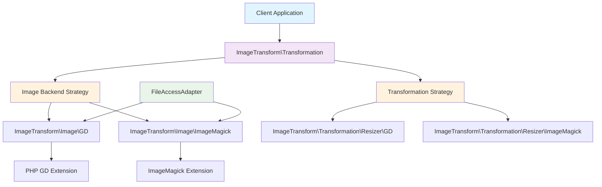
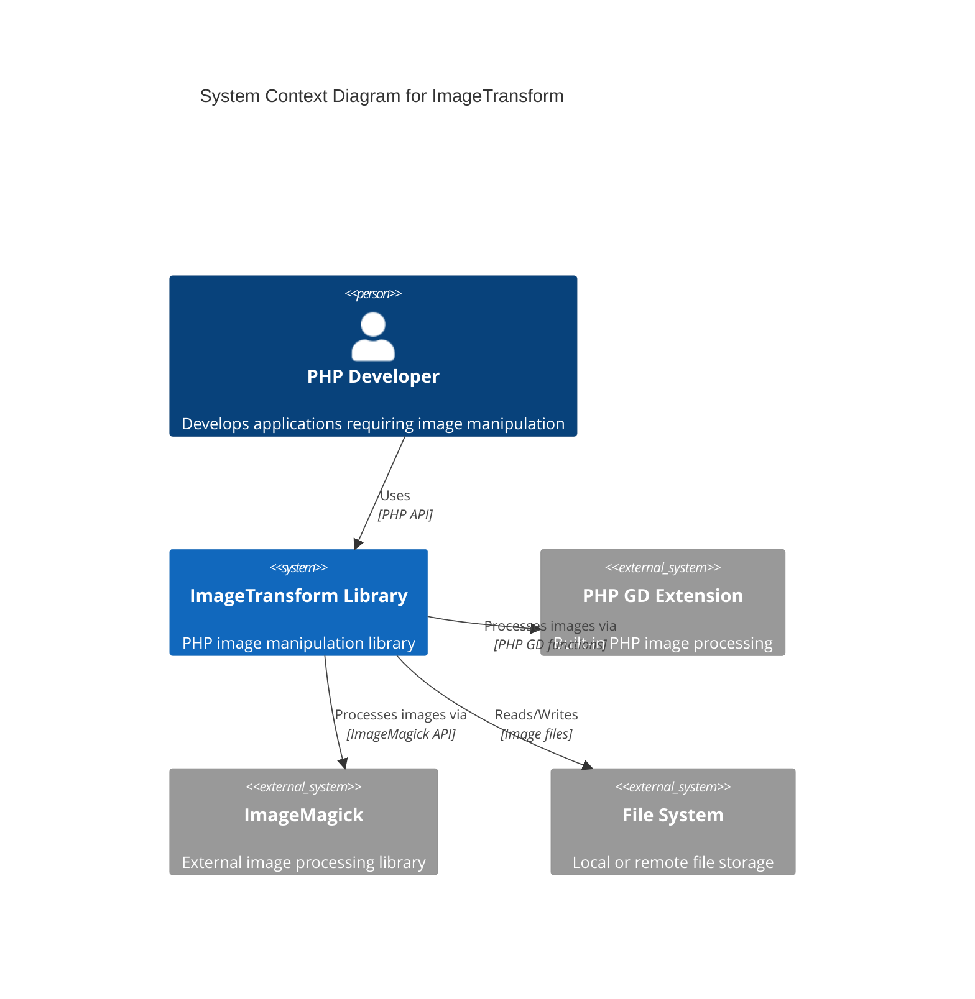
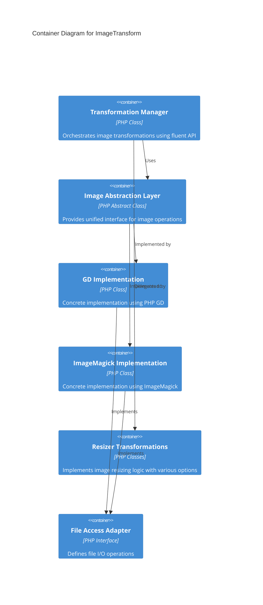
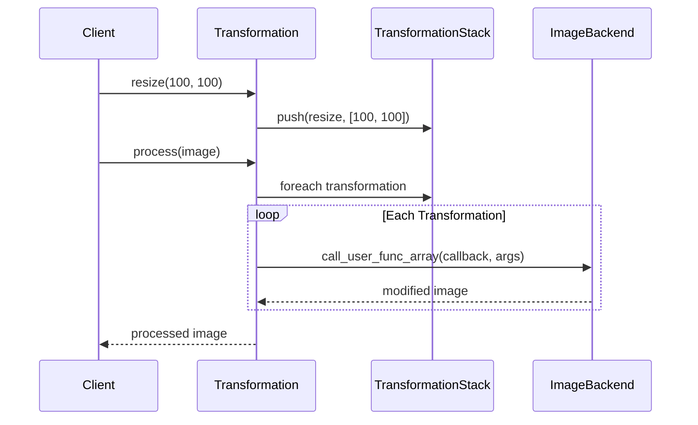
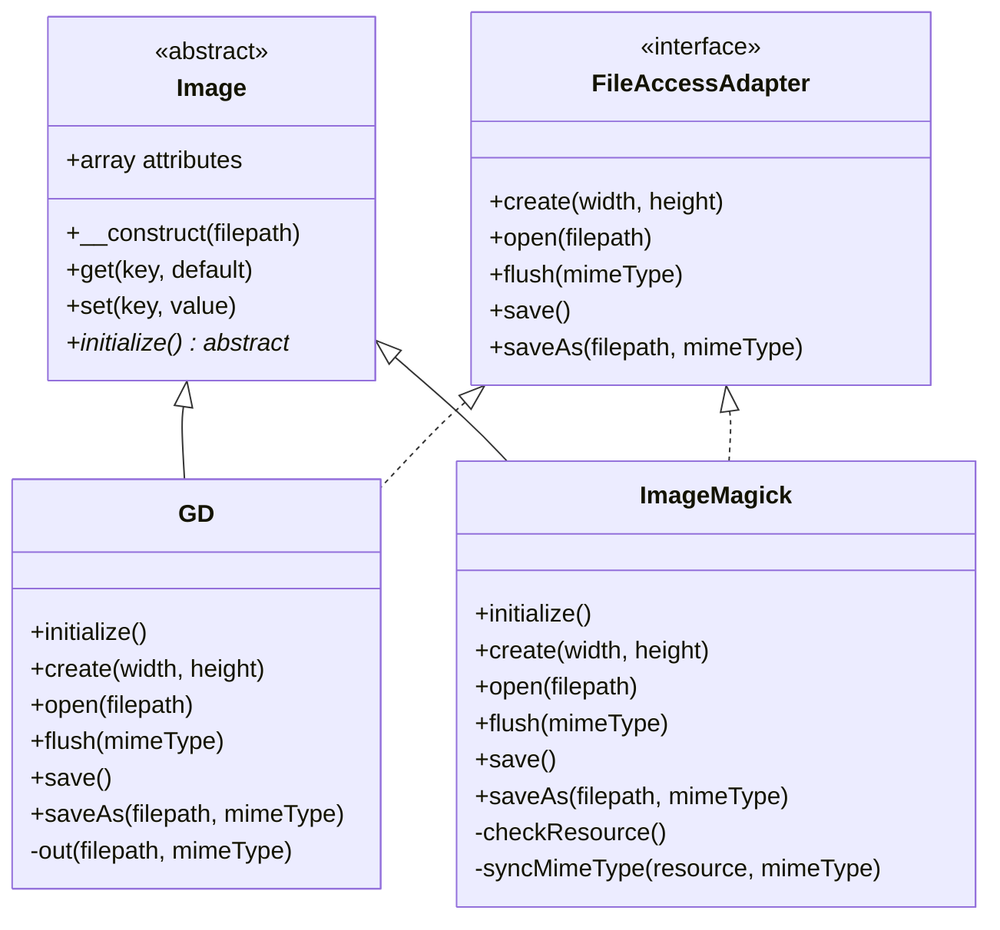
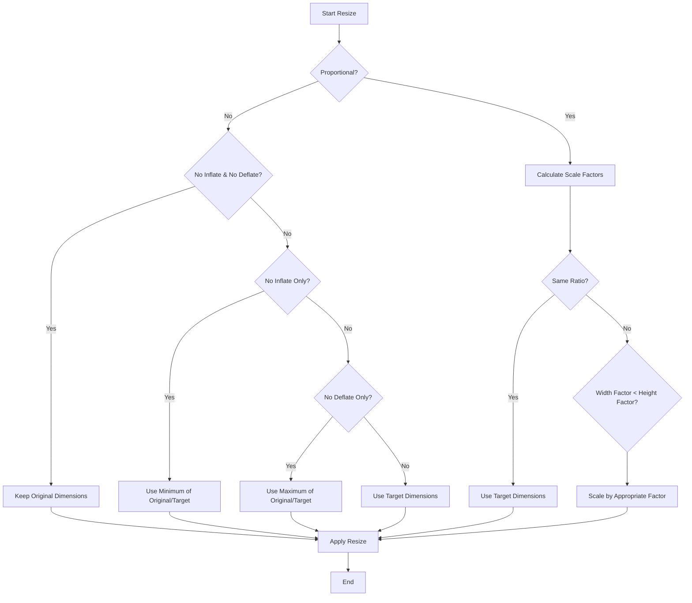
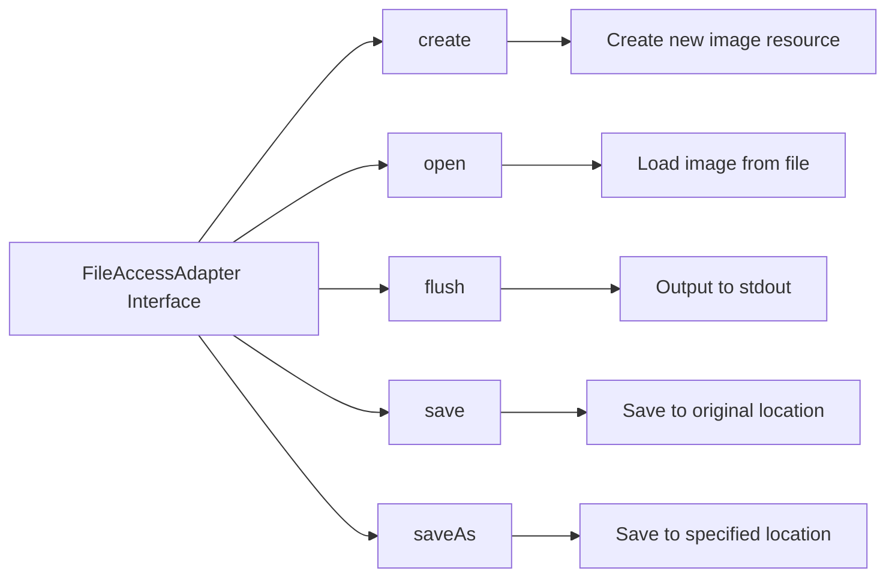
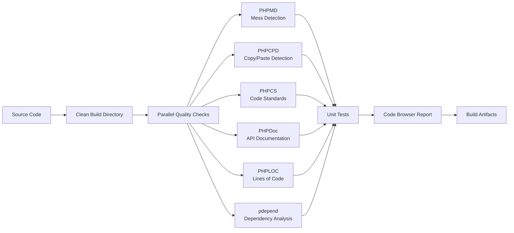
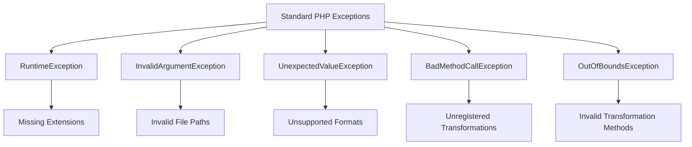

# ImageTransform Architecture Documentation

## Overview

ImageTransform is a PHP image manipulation library that provides a flexible, extensible framework for applying transformations to images. The library employs a strategy pattern with dual backend support, allowing developers to choose between PHP GD and ImageMagick implementations based on their specific requirements and available system resources.

## Core Architecture

### High-Level System Design



### C4 Context Diagram



### C4 Container Diagram



## Core Components

### 1. Transformation Layer

**Class**: `ImageTransform\Transformation`

The central orchestrator that manages the transformation pipeline through a fluent API.

#### Key Responsibilities:
- Maintains a stack of transformations to be applied
- Provides method chaining capabilities
- Manages transformation registration and callback resolution
- Processes the transformation stack against Image instances

#### Key Methods:
```php
// Dynamic method calling for registered transformations
public function __call($method, $arguments)

// Process transformation stack
public function process(\ImageTransform\Image $image)

// Register new transformation callbacks
public static function addTransformation($transformation)
```

#### Process Flow:


### 2. Image Abstraction Layer

**Base Class**: `ImageTransform\Image`

Provides a unified interface for image operations regardless of the underlying backend implementation.

#### Key Responsibilities:
- Abstract image resource management
- Attribute storage for image metadata
- Initialization delegation to concrete implementations

#### Concrete Implementations:

##### GD Implementation (`ImageTransform\Image\GD`)
- Utilizes PHP's built-in GD extension
- Supports JPEG, PNG, and GIF formats
- Lightweight and widely available

##### ImageMagick Implementation (`ImageTransform\Image\ImageMagick`)
- Leverages ImageMagick's advanced capabilities
- Broader format support
- Enhanced image quality and feature set



### 3. Transformation Implementations

#### Resizer Transformation

**Base Class**: `ImageTransform\Transformation\Resizer`

Handles image resizing with sophisticated dimension calculation logic.

##### Resize Flags:
- `PROPORTIONAL`: Maintains aspect ratio
- `NO_INFLATE`: Prevents enlarging images beyond original size
- `NO_DEFLATE`: Prevents reducing images below target size
- `MINIMUM`: Uses minimum dimension for proportional scaling

##### Algorithm Flow:


## File I/O Architecture

### FileAccessAdapter Interface

Standardizes file operations across different image backends:



#### Supported Operations:
- **create(width, height)**: Generate blank image canvas
- **open(filepath)**: Load existing image file
- **flush(mimeType)**: Stream image to stdout
- **save()**: Overwrite original file
- **saveAs(filepath, mimeType)**: Save with new name/format

## Technology Stack

### Core Dependencies

| Component | Version | Purpose |
|-----------|---------|---------|
| PHP | ≥5.3.2 | Runtime environment |
| GD Extension | - | Basic image processing |
| ImageMagick Extension | - | Advanced image processing |
| Symfony UniversalClassLoader | - | PSR-0 autoloading |

### Development Dependencies

| Tool | Purpose |
|------|---------|
| PHPUnit | Unit testing framework |
| Apache Ant | Build automation |
| PHPMD | Mess detection |
| PHPCPD | Copy/paste detection |
| PHPCS | Code style checking |
| PHPDoc | API documentation |

### Build Pipeline



## Extension Points

### Creating Custom Transformations

The library supports custom transformations through the registration system:

```php
// 1. Create transformation class
class CustomTransformation
{
    public function customEffect(\ImageTransform\Image $image, $param1, $param2)
    {
        // Implementation logic
        return $image;
    }
}

// 2. Register transformation
Transformation::addTransformation(new CustomTransformation());

// 3. Use in fluent API
$transformation = new Transformation();
$transformation->customEffect($param1, $param2);
```

### Adding New Image Backends

Extend the `Image` class and implement `FileAccessAdapter`:

```php
class NewBackend extends \ImageTransform\Image implements \ImageTransform\FileAccessAdapter
{
    protected function initialize()
    {
        // Backend-specific initialization
    }
    
    // Implement all FileAccessAdapter methods
}
```

## Performance Considerations

### Backend Selection Guidelines

| Scenario | Recommended Backend | Rationale |
|----------|-------------------|-----------|
| Simple operations, minimal dependencies | GD | Lightweight, built-in |
| Complex transformations, quality critical | ImageMagick | Superior algorithms |
| High-volume processing | ImageMagick | Better performance for batch operations |
| Memory-constrained environments | GD | Lower memory footprint |

### Memory Management

- Both backends handle resource cleanup automatically
- Large images should be processed in chunks where possible
- Consider streaming for web output to reduce memory usage

## Error Handling

### Exception Hierarchy



### Error Recovery Strategies

1. **Graceful Degradation**: Fall back to alternative backends
2. **Validation**: Check file accessibility before processing
3. **Format Detection**: Verify MIME types before operations
4. **Resource Checks**: Validate image resources exist

## Security Considerations

### Input Validation

- File path sanitization required for user inputs
- MIME type validation prevents malicious uploads
- Resource limits should be enforced for memory usage

### File Access Controls

- Implement proper permissions checking
- Validate file extensions against allowed types
- Consider implementing file size limits

## Integration Patterns

### Basic Usage Pattern

```php
// Setup
$image = new \ImageTransform\Image\GD('source.jpg');
$transformation = new \ImageTransform\Transformation();

// Register transformations
\ImageTransform\Transformation::addTransformation(new \ImageTransform\Transformation\Resizer\GD());

// Apply transformations
$transformation
    ->resize(800, 600, Resizer::PROPORTIONAL)
    ->process($image);

// Output
$image->saveAs('output.jpg');
```

### Batch Processing Pattern

```php
$files = glob('images/*.jpg');
$transformation = new \ImageTransform\Transformation();
$transformation->resize(200, 200, Resizer::PROPORTIONAL | Resizer::MINIMUM);

foreach ($files as $file) {
    $image = new \ImageTransform\Image\GD($file);
    $transformation->process($image);
    $image->saveAs('thumbnails/' . basename($file));
}
```

### Web Service Integration

```php
// Stream directly to browser
$image = new \ImageTransform\Image\GD($_GET['image']);
$transformation = new \ImageTransform\Transformation();
$transformation->resize($_GET['width'], $_GET['height']);
$transformation->process($image);

header('Content-Type: image/jpeg');
$image->flush('image/jpeg');
```

## API Reference Summary

### Main Classes

| Class | Purpose | Key Methods |
|-------|---------|-------------|
| `Transformation` | Orchestration | `__call()`, `process()`, `addTransformation()` |
| `Image\GD` | GD Backend | `create()`, `open()`, `save()`, `flush()` |
| `Image\ImageMagick` | ImageMagick Backend | `create()`, `open()`, `save()`, `flush()` |
| `Transformation\Resizer` | Resize Logic | `resize()`, `computeFinalDimension()` |

### Interfaces

| Interface | Purpose | Methods |
|-----------|---------|---------|
| `FileAccessAdapter` | File Operations | `create()`, `open()`, `flush()`, `save()`, `saveAs()` |

This architecture provides a solid foundation for image manipulation while maintaining flexibility for future enhancements and extensions.